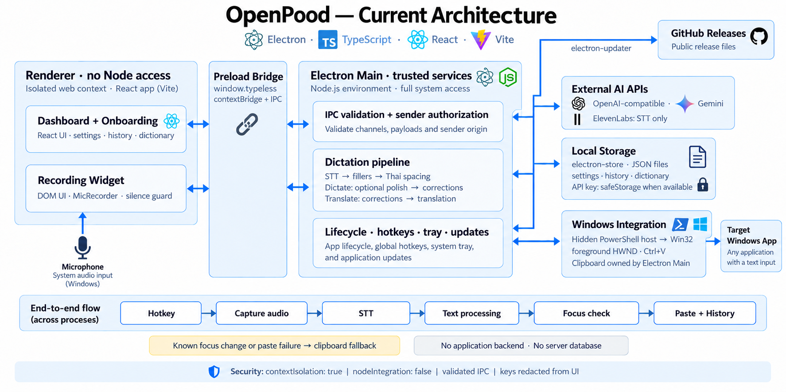
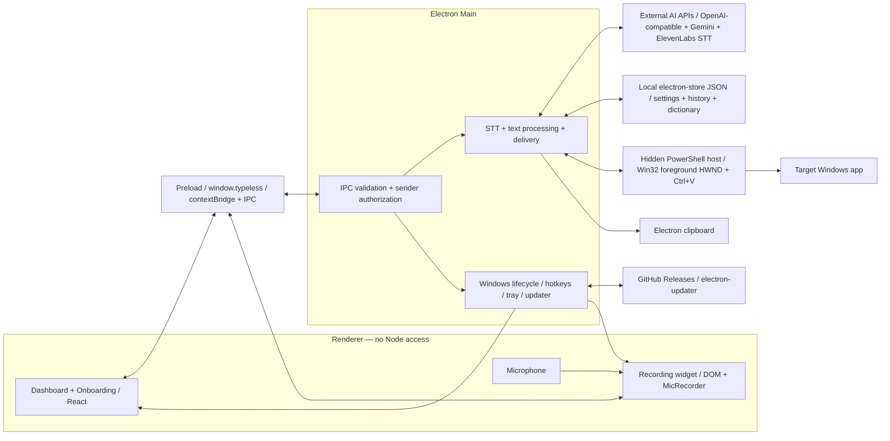

# OpenPood — Current Architecture

Source-checked on 2026-10-05. This describes the implemented Windows app, not a proposed refactor.

## Editable topology

## Source ownership

| Boundary | Current files | Responsibility |
| --- | --- | --- |
| Renderer | `src/app/main.ts`, `src/app/shell.tsx`, `src/pages/*.tsx` | Surface routing, React dashboard and onboarding |
| Audio | `src/runtime/widget.ts`, `src/runtime/recorder.ts` | DOM widget, microphone capture, silence/short-recording guards |
| Bridge | `electron/preload.ts`, `src/types.d.ts` | Typed `window.typeless` API; synchronize both when changing IPC |
| Main | `electron/main.ts` | Sender authorization, payload validation, hotkeys, orchestration, windows, tray |
| Providers | `electron/transcribe.ts`, `gemini.ts`, `elevenlabs.ts`, `llm.ts` | Main-process network calls; ElevenLabs supports STT only |
| Text | `electron/stripFillers.ts`, `polish.ts`, `translate.ts`, `dictionary.ts` | Local cleanup/corrections and optional remote text processing |
| Storage | `electron/storage.ts`, `migration.ts`, `config.ts`, `history.ts`, `dictionary.ts` | Local JSON, legacy migration, API-key protection |
| Windows | `electron/winHost.ts`, `powershell.ts`, `pasteText.ts`, `activeWindow.ts` | Hidden host, foreground lookup, physical Ctrl+V, clipboard delivery |
| Updates | `electron/updater.ts`, `src/components/UpdatePanel.tsx`, `package.json` | Main-owned update controller, dashboard actions, GitHub feed |

## Processing order

1. Global hotkey captures foreground information and signals the widget.
2. Renderer records audio and rejects silent/short recordings.
3. Main authorizes the sender and validates the audio payload (maximum 50 MiB).
4. Configured provider transcribes audio; local filler removal precedes Thai spacing normalization.
5. Dictate: optional AI polish, then corrections. Translate: corrections, then translation.
6. Compare foreground HWND, deliver text, then save history and notify the dashboard.

## Security and verification limits

- Keep renderer access behind the preload bridge: `contextIsolation: true`, `nodeIntegration: false`.
- API keys are redacted from returned settings; `safeStorage` encrypts them when available. Current code falls back to plaintext if encryption is unavailable.
- A known changed HWND skips paste; paste failure leaves text on the clipboard. Missing captured target or failed foreground lookup still permits a paste attempt in current code.
- There is no application backend or server database. Audio/text leaves the device when sent to the configured AI provider.
- Microphone, hotkeys, focus, clipboard/paste, tray and updates require manual Windows verification.

See [system-design.md](system-design.md) for detailed behavior and failure paths.
